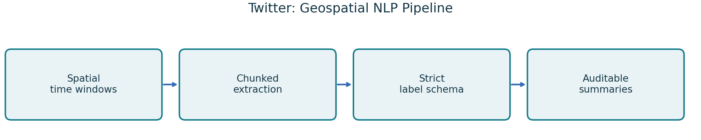
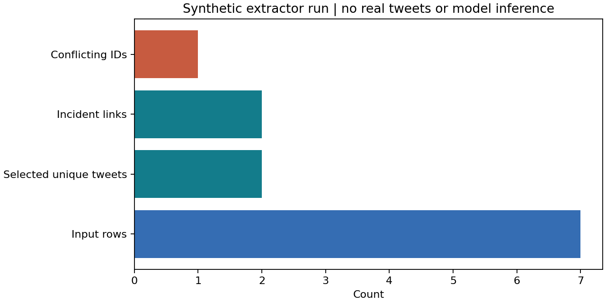
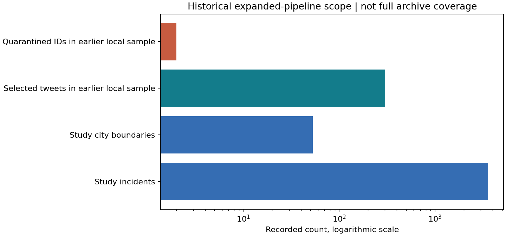

# Twitter Analysis: Geospatial NLP and Incident Linkage

[](https://github.com/Vinay-Vikkranth/twitter-geospatial-nlp/actions/workflows/validate.yml)

**Python · Shapely / PyProj · City-local time windows · SQLite checkpoints · Strict JSON labeling**

ASU Quark Lab research software connecting social media text with geographic and temporal incident context. The expanded study configuration contains **53 city boundaries, 3,578 incidents and 17,890 incident-day windows**. This repository preserves the current extraction and labeling implementation and provides a runnable public example using invented tweets and a synthetic polygon.



**Status:** extraction logic and software regression checks exist. The full archive run, real Llama pilot, human-reviewed label benchmark and cluster throughput validation remain incomplete. A successful schema check is not evidence that a label is scientifically accurate.

## Run without accounts, archives or a GPU

Use Python 3.11 from the repository root:

```bash
python -m venv .venv
# Windows: .venv\Scripts\activate
# macOS/Linux: source .venv/bin/activate
python -m pip install -r requirements.txt
python scripts/demo.py
python -m unittest discover -s tests -v
```

The sample calls the **actual chunked `process_file` extraction function** with seven invented rows and one synthetic polygon. It includes an exact duplicate, conflicting versions of one ID, an outside-polygon record, a non-keyword record and UTC timestamps that cross the local calendar boundary. The expected output is two selected unique tweets, two incident links and one quarantined conflicting ID.



Outputs go to ignored `outputs/demo/`. The file named `schema_example_NOT_MODEL_OUTPUT.json` is a hand-written object passed through the strict validator. It is explicitly **not** an LLM result. No remote API, Hugging Face download, real tweet archive or GPU is used by the sample.

## Research workflow

1. Validate the fixed study population against the reference incidents. Use city plus state, approved historical aliases and explicitly declared boundary coordinate systems.
2. Convert NAD83 coordinates where required and match points to city polygons, including boundary edges. Build incident-relative days t through t minus 4 using each city's local date.
3. Read archive files in chunks. Validate IDs, timestamps and coordinates; apply the declared keyword policy. Preserve unique tweets and every eligible incident-day link rather than discarding multiple matches.
4. Collapse exact duplicates. Quarantine conflicting variants of an ID even when one variant fails the keyword filter. Record files, hashes and failures for reproducibility.
5. For authorized model runs, request one strict JSON object containing a primary emotion, model-reported confidence, relevance, six thematic intensities and an emotion-preserving summary. Pin a model revision; do not silently change models or invent neutral defaults.
6. Use SQLite transactions and fingerprints to resume interrupted work. Export summaries with valid, failed, low-confidence and unlabelled counts separated. Unknown coverage is not zero activity.

## Versions and evidence

| Track | Scope | Evidence and boundary |
|---|---|---|
| Legacy LLM / summary experiments | 1,624 summary records, four-event experiment | Separate Llama/Qwen/RoBERTa workflow; label agreement is not human accuracy |
| Current expanded GIS pipeline | 53 boundaries, 3,578 incidents, 17,890 windows | Local sample extraction and recorded regression checks; full archive and real model pilot pending |
| Separate Project 53 ML | 14,415 cells | Distinct experiment; do not merge with the 35-city gun violence study |
| Public repository demo | Seven invented rows | Fresh execution of the extractor plus strict schema checks |

The earlier real local sample selected 303 unique tweets and 303 links with two conflicting IDs quarantined. Raw sample tweets and user identifiers are **not redistributed** here. These counts describe that saved local run, not archive completeness or predictive quality. A legacy agreement change from 31.8% to 44.5% involved a changed model checkpoint and cannot be advertised as human-label accuracy improvement.

## Repository guide

| Path | Purpose |
|---|---|
| `pipeline/study.py` | Population validation, timezones and keyword matching |
| `pipeline/extract.py` | Chunk reading, spatial matching, conflict quarantine and coverage |
| `pipeline/labels.py` | Prompt, taxonomies, strict validation and model backend |
| `pipeline/common.py` | Hashes, locks, SQLite, verified publication and checkpoints |
| `boundary53.py` | Registry, coordinate and boundary handling |
| `run.py` | Full research CLI; requires authorized research inputs |
| `scripts/demo.py` | Public synthetic extractor demonstration |
| `research/` | Cleared legacy notebooks and original research tests |
| `docs/RESEARCH_WORKFLOW.md` | Detailed original expanded-pipeline operational guide |
| `docs/REPRODUCIBILITY.md` | Public versus research setup and dependencies |

## Model and data access

The small public requirements file intentionally excludes Torch and Transformers. To run real labeling, install requirements-research.txt with an appropriate CUDA build if needed, acquire model access under its license, use private environment credentials and record an immutable revision. A Slurm template is a template, not proof of submitted cluster work or Harvard employment.

City-day coincidence does not establish that a tweet discusses a particular incident. Model confidence is self-reported and uncalibrated. Human review must assess relevance, language, category reliability and summary faithfulness. Keyword ambiguity, GPS quality, city boundaries and archive completeness all affect interpretation. This is research software, not a monitoring or enforcement system.

## Attribution

Vinay Vikkranth Subramanian's ASU Quark Lab work with Dr. Asish Satpathy; the current expanded pipeline adapts teammate **Avantika Tiwari's** source. Legacy and expanded versions are kept distinct. See [provenance](docs/PROVENANCE.md), [verification](docs/VERIFICATION.md) and [NOTICE](NOTICE.md). No raw tweets, credentials, model weights or unpublished manuscripts are committed.

## Recorded research evidence



The 303 selected tweets and two conflicting IDs belong to an earlier local sample. No original tweet text or IDs are included. Counts are not label accuracy or archive completeness.
